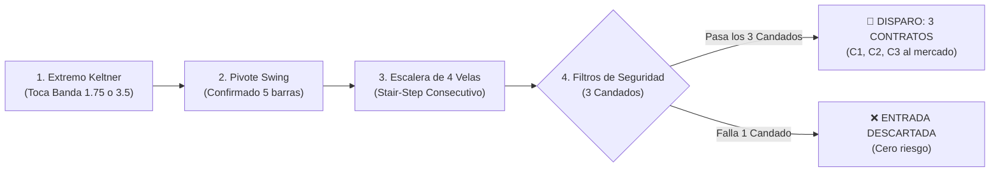
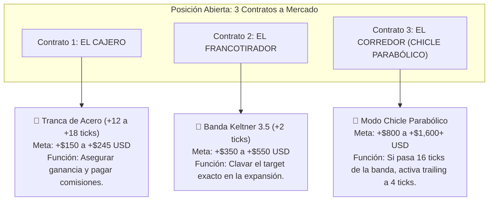

# FICHA TÉCNICA Y GUÍA MAESTRA: AS 3 - RATCHET v6.0
> **Estrategia Algorítmica Multicontrato de Expansión Swing en NinjaTrader 8**  
> *Optimizada para Futuros del S&P 500 (ES / MES) en Gráficas de 610 Ticks*

---

## 1. RESUMEN EJECUTIVO & IDENTIDAD
* **Nombre de la Estrategia:** As 3: Ratchet (Swing Surfer Multicontrato).
* **Filosofía:** Francotirador institucional paciente. No persigue el mercado; espera que el precio se sobre-extienda a extremos de Keltner (trampa institucional), detecta un giro confirmado de 4 velas y lanza un escuadrón táctico de 3 contratos independientes.
* **Instrumento:** Futuros del S&P 500 (ES) / Micro (MES).
* **Tick Size:** 0.25 (1 punto = 4 ticks = $50 USD en ES / $5 USD en MES).
* **Tipo de Gráfica:** 610 Ticks (Barras transaccionales de volumen/flujo, no de tiempo).
* **Horario Operativo:** 10:00 AM – 03:45 PM EST (Cierre forzoso a las 04:00 PM EST).

---

## 2. EL GATILLO DE ENTRADA: LA SECUENCIA DE 4 VELAS

Para disparar una orden, Ratchet exige una conjunción matemática perfecta:

### Reglas de la Escalera de 4 Velas:
1. **Vela 1:** Es la vela de giro inmediata al Swing Low (en compras) o Swing High (en ventas).
2. **Vela 2 (Despegue):** En Largos, `Low[0] > Low[1]`. En Cortos, `High[0] < High[1]`.
3. **Vela 3 (Presión):** Continuación del avance sin violar la estructura.
4. **Vela 4 (Disparo):** Cierra en la dirección del movimiento, confirmando el impulso.

---

## 3. LOS 3 CANDADOS DE SEGURIDAD PRE-DISPARO

Antes de que se envíe la orden de 3 contratos, el algoritmo revisa estos 3 filtros obligatorios:

| Candado | Parámetro en NT8 | Valor por Defecto | Propósito / Qué Evita |
| :--- | :--- | :---: | :--- |
| **1. Anti-Chiripa (Despegue Mínimo)** | `RatchetMinLowSeparationTicks` | **8 Ticks** (2.0 pts) | Evita entrar si el giro está "pegado" al pivote sin fuerza real. |
| **2. Anti-Persecución (Tope al Swing)** | `RatchetMaxSeparationTicks` | **24 Ticks** (6.0 pts) | **Regla de Oro v6.0:** Si el precio ya corrió más de 6 puntos desde el swing, descarta la entrada para no comprar techos ni vender suelos tardíos. |
| **3. Anti-Kamikaze (Agotamiento Exterior)** | Filtro de Keltner 3.5 | Cierre $< \text{Banda 3.5}$ | Si la vela 4 ya cerró por fuera de la Banda Grande 3.5, se cancela para no disparar contra un clímax agotado. |
| **4. Enfriamiento Post-Pérdida (Anti-Ametralladora)** | `RatchetLossCooldownBars` | **20 Barras** (~7-10 min) | Tras un Stop Loss o aborto por asfixia, congela nuevas entradas en la misma dirección para evitar ciclos de revancha (revenge-trading). |

---

## 4. GESTIÓN ACTIVA Y CHEQUEO DE SALUD (HEALTH-CHECK)

> [!TIP]
> **Chequeo de Salud a las 10 Barras (Salida por Asfixia):**  
> Si a las **10 barras** (`RatchetHealthCheckBars = 10`) el Contrato 1 NO ha podido cobrar su Tranca, la posición va en pérdida o ganancia insignificante ($\le 4\text{ ticks}$), **Y la pendiente de la Línea Media está en contra** ($\le 0$ para compras o $\ge 0$ para ventas):  
> $\longrightarrow$ El algoritmo aborta la posición de inmediato con etiqueta `Exit_Ratchet_Asfixia10b` y activa el enfriamiento de 20 barras, **ahorrando hasta un 70% del valor de un Stop Loss completo**.

---

## 4. EL ESCUADRÓN TÁCTICO: GESTIÓN DE LOS 3 CONTRATOS

Ratchet no cierra los 3 contratos al mismo tiempo; divide la posición en 3 roles independientes:

### Tabla de Salidas Detallada:
1. **Contrato 1 (El Cajero):**
   * Sale en `Exit_Ratchet_C1_Tranca` cuando el trade avanza favorablemente. 
   * Transforma el trade en un escenario de "Cero Estrés".
2. **Contrato 2 (El Francotirador):**
   * Sale en `Exit_Ratchet_C2_Upper35` o `Exit_Ratchet_C2_Lower35`.
   * Precio límite: Nivel exacto de la Banda Keltner Grande 3.5 con un offset de 2 ticks (`RatchetC2UpperBigOffsetTicks = 2`).
3. **Contrato 3 (El Runner - Chicle Parabólico):**
   * Sale en `Exit_Ratchet_Choke4tk`.
   * Si el mercado explota en una súper-tendencia y se sale **16 ticks** de la Banda 3.5 (`RatchetChokeOutsideTicks = 16`), entra en **Fase 4**.
   * Pega un trailing stop ceñido a solo **4 ticks** del máximo/mínimo (`RatchetChicleTicks = 4`). No sale hasta que el mercado retroceda 1 punto completo.

---

## 5. LA ESCALERA MECÁNICA: PISOS DEFENSIVOS DINÁMICOS

A medida que el mercado avanza a nuestro favor, el Stop Loss no se queda quieto; sube automáticamente protegiendo el capital:

* **Piso 0 (Inicial):** SL fijado en el extremo del Swing anterior.  
  *(Blindaje v6.0: Tope máximo de 24 ticks = $900 USD de pérdida máxima total en 3 contratos).*
* **Piso 1 (MidLine Conquistada):** Cuando el precio cruza la línea media de Keltner, el SL se arrastra para reducir drásticamente el riesgo.
* **Piso 2 (Banda 1.75 Conquistada):** Si el precio toca la banda pequeña 1.75, el SL se ancla en esa banda.
* **Piso 3 (Banda 3.5 Conquistada):** Si el precio conquista la banda exterior, el SL se ancla en la 3.5 protegiendo el 80% de la ganancia.
* **La Tranca de Adamantium (+$600 Flotante):** Si el PnL no realizado de la posición supera **+$600 USD**, se dispara un candado de emergencia que fija un piso mínimo garantizado en **+$500 USD netos**. ¡Un trade ganador de $600 nunca puede terminar en pérdida!

---

## 6. ESCUDO DIARIO Y CANDADO "A ESQUIAR" ⛷️

| Evento | Condición | Acción del Algoritmo |
| :--- | :--- | :--- |
| **Cortacircuito Diario** | Pérdida acumulada en el día $\le -\$650\text{ USD}$ | Liquidación inmediata y apagado total hasta el día siguiente. |
| **Candado "A Esquiar" ⛷️** | Trade 1 o Saldo Acumulado $\ge +\$450\text{ a } +\$500\text{ USD}$ | **Día finalizado.** Se bloquean nuevas entradas para proteger la victoria. |
| **Escalón 1 de Ganancia** | Saldo diario alcanza $+\$400\text{ USD}$ | Piso protegido en $+\$250\text{ USD}$. |
| **Escalón 2 de Ganancia** | Saldo diario alcanza $+\$600\text{ USD}$ | Piso protegido en $+\$500\text{ USD}$. |
| **Modo Dulce (Trailing Infinito)**| Saldo diario supera $+\$900\text{ USD}$ | Trailing stop de cuenta: Máximo ganado menos $\$150\text{ USD}$. |

---

## 7. MATRIZ DE PREGUNTAS RÁPIDAS (FLASHCARD)

* **¿Por qué 610 ticks y no velas de 5 minutos?**  
  Porque 610 transacciones reflejan la velocidad y volumen del flujo institucional (Order Flow), ignorando el tiempo muerto.
* **¿Qué pasa si el mercado se frena tras entrar?**  
  El Contrato 1 busca salir rápido con la Tranca de Acero. Si el precio retrocede, los pisos defensivos liquidan los otros contratos con mínima pérdida o ganancia marginal.
* **¿Qué hace el botón de pánico WPF?**  
  Al hacer clic o presionar `Ctrl + Espacio`, pausa inmediatamente la estrategia y liquida cualquier contrato abierto a mercado sin esperar confirmación.
