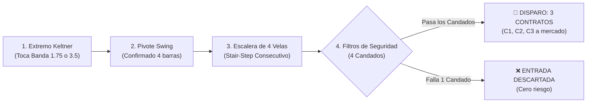
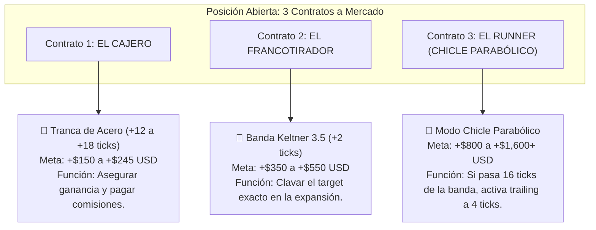

# 🎯 FICHA TÉCNICA Y GUÍA MAESTRA: AS 3 - RATCHET v7.0
> **Estrategia Algorítmica Multicontrato de Expansión Swing en NinjaTrader 8**  
> *Optimizada para Futuros del S&P 500 (ES / MES) en Gráficas de 610 Ticks*

---

## 1. RESUMEN EJECUTIVO & IDENTIDAD
* **Nombre de la Estrategia:** As 3: Ratchet (Swing Surfer Multicontrato v7.0).
* **Filosofía:** Francotirador institucional paciente con acción de precio pura. Espera giros confirmados de 4 velas tras sobre-extensiones en bandas de Keltner, y gestiona un escuadrón de 3 contratos independientes con protección temprana contra techos/suelos prematuros.
* **Instrumento:** Futuros del S&P 500 (ES) / Micro (MES).
* **Tick Size:** 0.25 (1 punto = 4 ticks = $50 USD en ES / $5 USD en MES).
* **Tipo de Gráfica:** 610 Ticks (Barras transaccionales de volumen/flujo, no de tiempo).
* **Horario Operativo:** 09:35 AM – 03:45 PM EST (Habilitado desde 09:35 AM en estado PAUSADO por seguridad; activación manual/discrecional con `Ctrl + Espacio`). Cierre forzoso a las 04:00 PM EST.

---

## 2. EL GATILLO DE ENTRADA: LA SECUENCIA DE 4 VELAS

### Reglas de la Escalera de 4 Velas:
1. **Vela 1:** Vela de giro inmediata al Swing Low (en compras) o Swing High (en ventas).
2. **Vela 2 (Despegue):** En Largos, `Low[0] > Low[1]`. En Cortos, `High[0] < High[1]`.
3. **Vela 3 (Presión):** Continuación del avance sin violar la estructura de la escalera.
4. **Vela 4 (Disparo):** Cierra en la dirección del movimiento, confirmando el impulso.

---

## 3. LOS 4 CANDADOS DE SEGURIDAD PRE-DISPARO

| Candado | Parámetro en NT8 | Valor por Defecto | Propósito / Qué Evita |
| :--- | :--- | :---: | :--- |
| **1. Anti-Chiripa (Despegue Mínimo)** | `RatchetMinLowSeparationTicks` | **8 Ticks** (2.0 pts) | Evita entrar si el giro está pegado al pivote sin fuerza real. |
| **2. Anti-Persecución (Tope al Swing)** | `RatchetMaxSeparationTicks` | **24 Ticks** (6.0 pts) | **Regla de Oro:** Si el precio ya corrió más de 6 puntos desde el swing, descarta la entrada para no comprar techos ni vender suelos tardíos. |
| **3. Anti-Kamikaze (Agotamiento Exterior)** | Filtro de Keltner 3.5 | Cierre $< \text{Banda 3.5}$ | Si la vela 4 ya cerró por fuera de la Banda Grande 3.5, cancela para no disparar contra un clímax agotado. |
| **4. Enfriamiento Post-Pérdida / Aborto (Cuarentena Total)** | `RatchetLossCooldownBars` | **40 Barras** (~15-20 min) | Tras un Stop Loss, Aborto Prematuro o Asfixia, congela por completo a Ratchet (tanto compras como ventas) para evitar ametrallamiento y revancha. |

---

## 4. BLINDAJE TEMPRANO v7.0: ABORTO POR SWING PREMATURO

> [!IMPORTANT]
> **Fase 0.3: Aborto Temprano por Swing Prematuro (Acción de Precio Pura v7.0):**  
> Al llegar a la barra **N** (`RatchetEarlySwingMaxBars = 6` barras por defecto) tras entrar:  
> 1. En **Compras (Longs)**: Evalúa el techo más reciente (puntos cian de `Swing High`). Si el precio actual está por debajo o tocándolo (`Close[0] <= swingHighPrice`), el rebote fracasó: **¡ABORTO INMEDIATO!** (`Exit_Ratchet_SwingPrematuro`) y activa la **cuarentena estricta de 40 barras**. Si por el contrario la vela cerró por encima del techo, supera la prueba y el trade sigue libre.  
> 2. En **Ventas (Shorts)**: Evalúa el suelo más reciente (puntos amarillos de `Swing Low`). Si el precio actual está por encima o tocándolo (`Close[0] >= swingLowPrice`), la caída fracasó: **¡ABORTO INMEDIATO!** (`Exit_Ratchet_SwingPrematuro`) y activa la **cuarentena estricta de 40 barras**. Si por el contrario la vela cerró por debajo del suelo, supera la prueba y el trade sigue libre.  
> *Si el trade arranca limpio y con fuerza, ningún swing obstáculo lo frena y avanza libremente hacia sus objetivos.*

---

## 5. EL ESCUADRÓN TÁCTICO: GESTIÓN DE LOS 3 CONTRATOS

### Roles y Salidas:
1. **Contrato 1 (El Cajero):** Sale en `Exit_Ratchet_C1_Tranca`. Desarma el riesgo del trade metiendo los primeros $150-$245 USD al banco.
2. **Contrato 2 (El Francotirador):** Sale en `Exit_Ratchet_C2_Upper35` o `Exit_Ratchet_C2_Lower35` al tocar la Banda Keltner 3.5 con offset de 2 ticks.
3. **Contrato 3 (El Runner - Chicle Parabólico):** Si supera 16 ticks fuera de Banda 3.5, activa trailing stop ceñido a **4 ticks** del extremo alcanzado (`Exit_Ratchet_Choke4tk`), surfeando megatendencias históricas.

---

## 6. PISOS DEFENSIVOS DINÁMICOS Y ESCUDO DIARIO

* **Piso 0 (Inicial):** SL fijado en el extremo del Swing con **tope inflexible de 24 ticks** ($900 USD en 3 contratos ES / $90 en MES).
* **Piso 1 (Línea Media):** Al cruzar la Midline, el SL se arrastra protegiendo el trade.
* **Piso 2 y 3 (Bandas 1.75 y 3.5):** El SL se ancla a las bandas conquistadas.
* **Tranca de Adamantium (+$600 Flotante):** Si el trade supera +$600 USD flotantes, garantiza un piso en **+$500 USD netos**. ¡Cero riesgo de devolver un trade grande!
* **Candado "A Esquiar" ⛷️:** Trade 1 con ganancia $\ge +\$450\text{ USD}$ apaga la operativa del día.
* **Cortacircuito Diario:** Pérdida máxima de $-\$650\text{ USD}$ liquida y apaga la estrategia.
