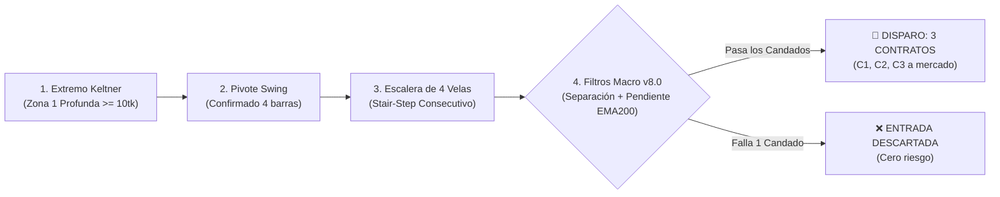
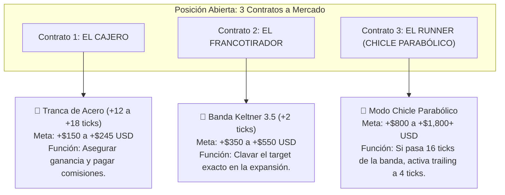

# 🎯 FICHA TÉCNICA Y GUÍA MAESTRA: AS 3 - RATCHET v8.0
> **Estrategia Algorítmica Multicontrato de Expansión Swing en NinjaTrader 8**  
> *Optimizada para Futuros del S&P 500 (ES / MES) en Gráficas de 610 Ticks*

---

## 1. RESUMEN EJECUTIVO & IDENTIDAD
* **Nombre de la Estrategia:** As 3: Ratchet (Swing Surfer Multicontrato v8.0).
* **Filosofía:** Francotirador institucional paciente con acción de precio pura y filtros macro de alta velocidad. Espera giros confirmados de 4 velas tras sobre-extensiones en bandas de Keltner, y gestiona un escuadrón táctico de 3 contratos independientes con protección temprana contra techos/suelos prematuros y salvaguarda total de contratos corredores en la Tranca Universal.
* **Instrumento:** Futuros del S&P 500 (ES) / Micro (MES).
* **Tick Size:** 0.25 (1 punto = 4 ticks = $50 USD en ES / $5 USD en MES).
* **Tipo de Gráfica:** 610 Ticks (Barras transaccionales de volumen/flujo, no de tiempo).
* **Horario Operativo:** 09:35 AM – 03:45 PM EST (Habilitado desde 09:35 AM en estado PAUSADO por seguridad; activación manual con `Ctrl + Espacio`). Cierre forzoso a las 04:00 PM EST.

---

## 2. EL GATILLO DE ENTRADA: LA SECUENCIA DE 4 VELAS

### Reglas de la Escalera de 4 Velas:
1. **Vela 1:** Vela de giro inmediata al Swing Low (en compras) o Swing High (en ventas).
2. **Vela 2 (Despegue):** En Largos, `Low[0] > Low[1]`. En Cortos, `High[0] < High[1]`.
3. **Vela 3 (Presión):** Continuación del avance sin violar la estructura de la escalera.
4. **Vela 4 (Disparo):** Cierra en la dirección del movimiento, confirmando el impulso.

---

## 3. LOS NUEVOS CANDADOS DE SEGURIDAD PRE-DISPARO (v8.0)

| Candado | Parámetro en NT8 | Valor por Defecto | Propósito Técnico / Qué Evita |
| :--- | :--- | :---: | :--- |
| **1. Profundidad del Swing en Zona 1** | `RatchetMinSwingDepthTicks` | **10 Ticks** (2.5 pts) | **Novedad v8.0:** El Swing Low debe penetrar al menos 10 ticks por debajo de `Lower 1.75` (y el Swing High 10 ticks sobre `Upper 1.75`). Elimina pivotes tibios pegados a la frontera de Zona 2. Si penetra hacia o más allá de Banda 3.5, se permite libremente. |
| **2. Separación de EMA 200 a Canal Pequeño** | `RatchetEmaMinSeparationTicks` | **8 Ticks** (2.0 pts) | **Novedad v8.0:** La Línea Roja (EMA 200) no puede estar pegada a las bandas 1.75. Debe tener al menos 8 ticks de separación por fuera del canal pequeño para garantizar espacio aéreo macro y evitar compresión. |
| **3. Pendiente Normalizada de EMA 200** | `RatchetEmaMinSlopeThreshold` | **0.15** (LinReg/ATR) | **Novedad v8.0:** La EMA 200 debe llevar una pendiente inclinada real ($\ge +0.15$ para largos, $\le -0.15$ para cortos). Descarta mercados planos o dormidos con "miringas" de pendiente (0.01-0.02). |
| **4. Anti-Chiripa (Despegue Mínimo)** | `RatchetMinLowSeparationTicks` | **8 Ticks** (2.0 pts) | Evita entrar si el giro está pegado al pivote sin fuerza real. |
| **5. Anti-Persecución (Tope al Swing)** | `RatchetMaxSeparationTicks` | **24 Ticks** (6.0 pts) | Si el precio ya corrió más de 6 puntos desde el swing, descarta la entrada para no comprar techos ni vender suelos tardíos. |
| **6. Anti-Kamikaze (Agotamiento Exterior)** | Filtro de Keltner 3.5 | Cierre $< \text{Banda 3.5}$ | Si la vela 4 ya cerró por fuera de la Banda Grande 3.5, cancela para no disparar contra un clímax agotado. |
| **7. Enfriamiento Post-Pérdida / Aborto** | `RatchetLossCooldownBars` | **40 Barras** (~15-20 min) | Tras un Stop Loss o Aborto Prematuro, congela por completo a Ratchet para evitar ametrallamiento. |
| **8. Chequeo de Salud (Health-Check / Asfixia)** | `RatchetHealthCheckEnabled` | **False** (Opcional v8.0) | Póliza de seguro opcional: si a las 10 barras el trade no avanza y la pendiente está en contra, aborta. Viene desactivado por defecto a criterio del trader. |

---

## 4. BLINDAJE TEMPRANO: ABORTO POR SWING PREMATURO
* Al llegar a la barra **6** (`RatchetEarlySwingMaxBars = 6`):
  * **En Largos:** Evalúa el techo más reciente (puntos cian de `Swing High`). Si el precio está por debajo o tocándolo (`Close[0] <= swingHighPrice`), el rebote fracasó: **¡ABORTO INMEDIATO!** (`Exit_Ratchet_SwingPrematuro`) y cuarentena de 40 barras.
  * **En Cortos:** Evalúa el suelo más reciente (puntos amarillos de `Swing Low`). Si el precio está por encima o tocándolo (`Close[0] >= swingLowPrice`), la caída fracasó: **¡ABORTO INMEDIATO!** (`Exit_Ratchet_SwingPrematuro`) y cuarentena de 40 barras.

---

## 5. EL ESCUADRÓN TÁCTICO: GESTIÓN DE LOS 3 CONTRATOS & BUGFIX TRANCA

> [!IMPORTANT]
> **Blindaje de la Tranca Universal v8.0 (Rescate de C2 y C3):**  
> Si se activa la Tranca Universal por ganancia flotante y el mercado retrocede:  
> $\longrightarrow$ El algoritmo **SOLO liquida el Contrato 1** (`Exit_Ratchet_C1_Tranca`).  
> $\longrightarrow$ Los Contratos 2 y 3 quedan **100% inmunes a la Tranca Universal**, libres para buscar la Banda 3.5 y el Choke Parabólico (evitando liquidaciones tempranas de toda la posición como en la v7.0).

---

## 6. PISOS DEFENSIVOS DINÁMICOS Y ESCUDO DIARIO

* **Piso 0 (Inicial):** SL fijado en el extremo del Swing con tope inflexible de **24 ticks** ($900 USD en 3 contratos ES / $90 en MES).
* **Piso 1 (Línea Media):** Al cruzar la Midline, el SL se arrastra protegiendo el trade.
* **Piso 2 y 3 (Bandas 1.75 y 3.5):** El SL se ancla a las bandas conquistadas.
* **Candado "A Esquiar" ⛷️:** Trade 1 con ganancia $\ge +\$450\text{ USD}$ apaga la operativa del día.
* **Cortacircuito Diario:** Pérdida máxima de $-\$650\text{ USD}$ liquida y apaga la estrategia.
