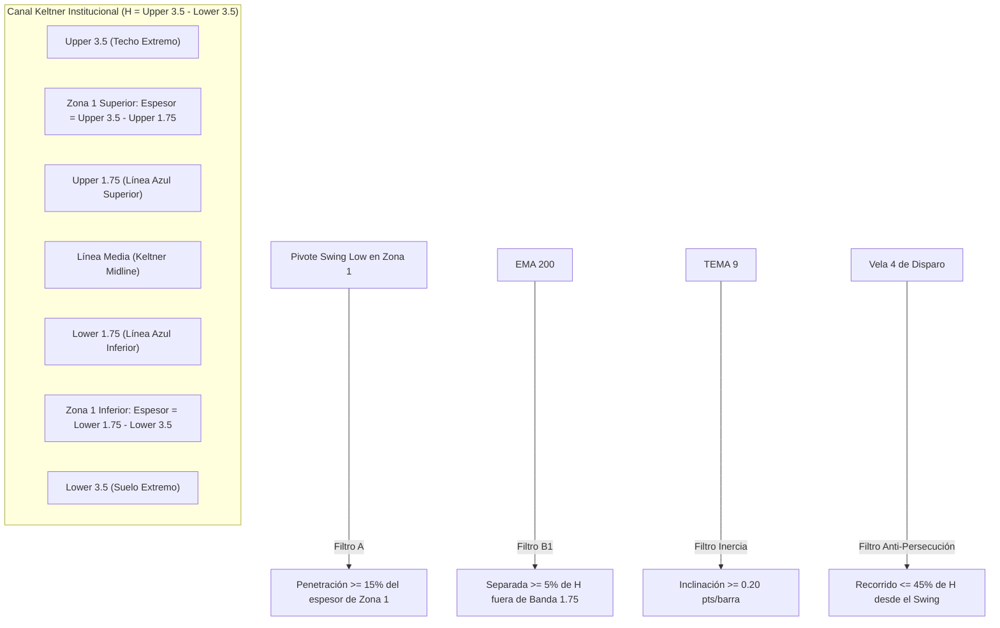

# 🎯 FICHA TÉCNICA Y GUÍA MAESTRA: AS 3 - RATCHET v8.1
> **Estrategia Algorítmica de Expansión Porcentual Multicontrato en NinjaTrader 8**  
> *Optimizada para Futuros del S&P 500 (ES / MES) en Gráficas de 610 Ticks*

---

## 1. RESUMEN EJECUTIVO & IDENTIDAD
* **Nombre de la Estrategia:** Tick610_CascadaVegaES ("Cascada Vega ES").
* **Versión Oficial:** **8.1 - Cascada Vega ES**.
* **Filosofía v8.1:** Francotirador institucional paciente con **arquitectura porcentual auto-adaptativa**. Elimina las debilidades de umbrales fijos en ticks que fallaban en canales hiper-anchos o hiper-angostos, adaptando dinámicamente la profundidad del swing, la separación de la EMA 200 y el límite anti-persecución a la volatilidad real del mercado en cada barra.
* **Instrumento:** Futuros del S&P 500 (ES) / Micro (MES). Multiplicador automático por instrumento.
* **Tick Size:** 0.25 (1 punto = 4 ticks = $50 USD en ES / $5 USD en MES).
* **Tipo de Gráfica:** 610 Ticks (Barras transaccionales de volumen/flujo, no de tiempo).
* **Horario Operativo:** 09:35 AM – 03:45 PM EST (Inicia en estado PAUSADO por seguridad; activación manual con botón WPF en gráfica o `Ctrl + Espacio`). Cierre forzoso a las 04:00 PM EST.

---

## 2. LA REVOLUCIÓN DE LA VERSIÓN 8.1: ARQUITECTURA PORCENTUAL DINÁMICA

En las versiones anteriores (v7.0 y v8.0), los filtros utilizaban distancias fijas en ticks (ej. 10 ticks, 24 ticks). En canales estrechos (10-15 pts), 10 ticks consumían casi toda la Zona 1; pero en canales gigantes (40-60 pts), 10 ticks apenas representaban una mecha insignificante. 

La **Versión 8.1** resuelve esto de forma definitiva mediante **geometría proporcional al régimen de volatilidad**:

---

## 3. TABLA COMPARATIVA DE CANDADOS: v8.0 vs v8.1

| Candado / Módulo | Implementación v8.0 | Nueva Arquitectura v8.1 | Razón Técnica y Beneficio Cuantitativo |
| :--- | :---: | :---: | :--- |
| **1. Profundidad del Swing en Zona 1** | Fijo: 10 ticks (2.5 pts) | **Porcentual: 15.0%** del espesor de Zona 1 | Exige descuento proporcional real. En un canal ancho de 16 pts en Zona 1, exige 2.4 pts de penetración; en canal angosto de 6 pts, exige 0.9 pts. Cero pivotes tibios. |
| **2. Filtro Anti-Persecución** | Fijo: 24 ticks (6.0 pts) | **Porcentual: 45.0%** del canal total | Prohíbe entrar si el precio ya consumió casi la mitad del canal desde el suelo/techo. Elimina compras tardías en techos o ventas en suelos. |
| **3. Separación EMA 200 a Banda 1.75** | Fijo: 8 ticks (2.0 pts) | **Porcentual: 5.0%** del canal total | Asegura que la EMA 200 esté despegada del canal pequeño en proporción a la volatilidad diaria. Evita zonas de compresión y picadillo ("choppiness"). |
| **4. Pendiente EMA 200** | Umbral: 0.15 | **Umbral: 0.00** ($\ge 0$ Long / $\le 0$ Short) | Solo exige dirección macro favorable (alcista en compras, bajista en ventas) sin bloquear inicios de expansión cuando la EMA 200 aún no alcanza aceleración alta. |
| **5. Inercia de Medias Rápidas (TEMA 9)** | Solo $> 0$ Long / $< 0$ Short | **Pendiente Mínima: 0.20 pts/barra** | Elimina rebotes lentos y anémicos ("miringas" de pendiente de 0.02) donde el mercado se queda en rango lateral tras el giro. |
| **6. Liquidación Monocontrato en Banda 3.5** | Flotaba como Runner | **Liquidación Inmediata al toque** (Offset 0) | Si la cuenta desescaló a 1 contrato (o modo 1 contrato manual), cobra inmediatamente al tocar Banda 3.5 (+20 a +25 ticks en el banco), sin dejar que la ganancia se esfume. |
| **7. Offset de Salida C2 en Banda 3.5** | +2 ticks fuera | **0 ticks (toque exacto)** | Garantiza llenado inmediato al tocar la banda exterior sin depender de un rebase excesivo. |
| **8. Ventana Aborto por Swing Prematuro** | 6 barras | **10 barras de respiro** | Le da 4 barras más de respiro al trade para digerir la prueba de resistencia antes de abortar. |
| **9. Despegue Mínimo Base Swing** | 8 ticks (2.0 pts) | **6 ticks (1.5 pts)** | Da un poco más de flexibilidad al despegue inicial de la vela 4 sin perder robustez. |
| **10. Choke Parabólico Fuera de Banda 3.5** | 16 ticks | **12 ticks fuera** | Ceñimiento más oportuno del Runner al entrar en súper-expansión exterior. |

---

## 4. GESTIÓN DEL ESCUADRÓN TÁCTICO: 3 CONTRATOS VS MONOCONTRATO

### Modo Escuadrón Completo (3 Contratos)
1. **Contrato 1 (El Cajero):** Cobra en la Tranca Universal de Escalón ($400, $600 o $900) con Sprint Bonus de +$100 USD. Asegura el día y paga comisiones.
2. **Contrato 2 (El Francotirador):** Liquidado en el toque exacto de **Banda Keltner 3.5** (`RatchetC2UpperBigOffsetTicks = 0`). Meta: +$350 a +$550 USD cerrados en el banco.
3. **Contrato 3 (El Astronauta Runner):** 100% inmune a la Tranca. Si supera los 12 ticks fuera de Banda 3.5, activa el **Choke Parabólico** con trailing a 4 ticks del extremo.

### Modo Monocontrato (1 Contrato por Desescalado de Cuenta o Configuración)
> [!IMPORTANT]
> **Regla de Oro v8.1:** Cuando la cuenta está desescalada a 1 contrato (por ejemplo, tras asegurar el piso de +$1,150 USD o por protección de margen), **el contrato único se liquida al tocar Banda 3.5** (`Exit_Ratchet_C2_Upper35` / `Exit_Ratchet_C2_Lower35`).  
> *Esto evita que una ganancia flotante de +25 ticks (+ $312.50 USD) se regrese a break-even o active el cortacircuito.*

---

## 5. INTERFAZ DE USUARIO Y ORDENAMIENTO EN NINJATRADER

Se corrigió el error de ordenamiento alfabético de la ventana de propiedades WPF de NinjaTrader 8 mediante numeración de dos dígitos (`01.` a `11.`):

* `01. Información` (Versión congelada v8.1)
* `02. Gestión de Posición` (Número de contratos)
* `03. Horario Operativo` (09:35 AM - 03:45 PM - 04:00 PM EST)
* `04. Escudo de Cuenta (3 Pisos)` (Cortacircuito -$650, Pisos +$250 / +$500, Modo Dulce +$900)
* `05. As 4: Cascada Surfer` (Apertura 10:00-10:10 AM, Umbrales 0.16 y 0.17)
* `06. As 3: Ratchet v8.1` (Arquitectura Porcentual, Anti-persecución 45%, TEMA 9 0.20)
* `07. Indicadores Macro` (TEMA 9, EMA 200, Keltner 52 / 3.5 / 1.75)
* `08. Franco-Tirador Trade 1 (TP Fijo)` (+$470 USD en Trade 1)
* `09. Clímax Ratchet Asfixiante` (Trades 2+ con meta flash $200 y respiro 3 ticks)
* `10. Victoria Temprana Trade 1` (A esquiar ⛷️ con +$450 USD en Trade 1)
* `11. Notificaciones Sonoras` (Alertas de apertura, pisos, cuarentenas y cierres)

Cada parámetro cuenta con su descripción institucional clara en español visible al pasar el mouse por encima (Tooltips).
