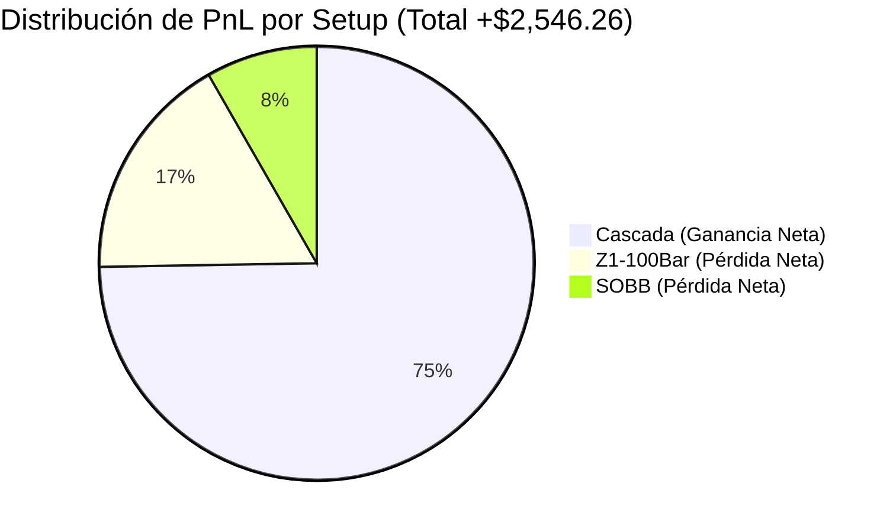

# 📊 Bitácora Oficial de Playback - Poker de Ases Sniper v11.4

* **Estrategia:** `Tick610_PokerDeAsesSniperES` (v11.4)
* **Instrumento:** ES 12-26 (Futuros E-mini S&P 500)
* **Gráfica:** 610 Ticks
* **Horario:** RTH (09:50 AM - 12:30 PM EST Corte de Mediodía / 04:00 PM EST Modo Dulce)
* **Periodo Auditado:** Del 21 de Septiembre al 30 de Octubre de 2026 (6 semanas completas / 30 sesiones de mercado)
* **Parámetros Clave v11.4:**
  * **Corte de Mediodía:** `12:30 PM` (`123000`) para blindar ganancias antes del almuerzo de NY.
  * **Cascada:** Pendiente `0.15` (LinReg/ATR) y Cuarentena de Saciedad de `30 minutos`.
  * **SOBB:** Pendiente `0.12` (LinReg/ATR).
  * **Escudos Diarios:** Cortacircuito -$650 USD, Escalón 1 (+$400 / Piso +$250), Escalón 2 (+$600 / Piso +$500), Modo Dulce (+$900 / Trailing Infinito $150).

---

## 📈 Resumen Ejecutivo Consolidado (Muestra Maestra: 6 Semanas / 30 Días)

| Métrica Consolidada | Resultado Global v11.4 |
| :--- | :--- |
| **Días Totales Auditados** | **30 días** (6 semanas completas) |
| **Días Operados / Días Neutrales** | **29 operados** / 1 neutral (28/10 con 0 trades en chop) |
| **Efectividad Diaria (Días Verdes)** | **17 Días Ganadores (58.6%)** vs 12 Días Perdedores |
| **Total Trades Disparados** | **79 trades** (promedio ~2.7 trades por día) |
| **Winrate de Trades** | **51.9%** (41 Wins / 38 Losses) |
| **Beneficio Bruto (Gross Profit)** | **+$9,479.38 USD** |
| **Pérdida Bruta (Gross Loss)** | **-$6,933.12 USD** |
| **Profit Factor** | **1.37** |
| **PnL TOTAL NETO ACUMULADO** | **+$2,546.26 USD** 💰 |
| **Promedio Diario Neto** | **+$87.80 USD / día operado** |

---

## 🗓️ Desglose Semanal Comparativo

| Semana | Fechas | Trades | W / L (%) | PnL Neto (USD) | Estado Semanal |
| :---: | :---: | :---: | :---: | :---: | :---: |
| **Semana 1** | 21/09 al 25/09/2026 | 10 | 4W / 6L (40.0%) | **+$197.68** | 🟢 Verde Moderado |
| **Semana 2** | 28/09 al 02/10/2026 | 13 | 8W / 5L (61.5%) | **+$1,301.46** | 🟢 Super Verde |
| **Semana 3** | 05/10 al 09/10/2026 | 12 | 4W / 8L (33.3%) | **-$777.32** | 🔴 Retroceso (Chop) |
| **Semana 4** | 12/10 al 16/10/2026 | 16 | 5W / 11L (31.3%) | **-$736.62** | 🔴 Retroceso (Rango áspero) |
| **Semana 5** | 19/10 al 23/10/2026 | 16 | 13W / 3L (81.3%) | **+$2,200.88** | 🟢 Semana Invicta (100% verde) |
| **Semana 6** | 26/10 al 30/10/2026 | 12 | 7W / 5L (58.3%) | **+$360.18** | 🟢 Verde Sólido |
| **TOTAL** | **21/09 al 30/10/2026** | **79** | **41W / 38L (51.9%)** | **+$2,546.26** | 🚀 **PROFIT NETO GLOBAL** |

---

## 📅 Registro Detallado Día a Día

### 🗓️ Semana 1: 21 al 25 de Septiembre de 2026 (+$197.68 USD)
| Fecha | Trades | Wins / Losses | PnL Neto | Resumen de Operaciones |
| :---: | :---: | :---: | :---: | :--- |
| **21/09/2026** | 2 | 1W / 1L (50%) | **+$266.28** | T1: Cascada Long Candado (+$283.14, MFE $462.50) \| T2: Cascada Long Candado (-$16.86, MFE $225.00). |
| **22/09/2026** | 1 | 0W / 1L (0%) | **-$179.36** | T1: Cascada Short SL Banda Opuesta (-$179.36). |
| **23/09/2026** | 2 | 1W / 1L (50%) | **+$141.28** | T1: Cascada Short Candado (+$208.14, MFE $312.50) \| T2: Cascada Short SL (-$66.86, MFE $162.50). |
| **24/09/2026** | 1 | 0W / 1L (0%) | **-$650.58** | T1: Z1-100Bar Long SL Midline (-$650.58). Cortacircuito actuó protegiendo la cuenta. |
| **25/09/2026** | 4 | 2W / 2L (50%) | **+$620.06** | T1: Cascada Short Candado (+$333.14) \| T2: Cascada Long BE (-$4.36) \| T3: Cascada Short SL (-$316.86) \| T4: Cascada Long Tranca de Acero (+$608.14, MFE $662.50). |

### 🗓️ Semana 2: 28 de Septiembre al 02 de Octubre de 2026 (+$1,301.46 USD)
| Fecha | Trades | Wins / Losses | PnL Neto | Resumen de Operaciones |
| :---: | :---: | :---: | :---: | :--- |
| **28/09/2026** | 3 | 2W / 1L (66.7%) | **+$674.42** | T1: Cascada Short Tranca Bonus (+$720.64, MFE $750) \| T2: Z1 Long SL (-$141.86) \| T3: Cascada Long Candado a las 12:20 PM (+$95.64). |
| **29/09/2026** | 2 | 1W / 1L (50%) | **-$58.72** | T1: Cascada Short Candado (+$70.64) \| T2: Cascada Short SL Banda Opuesta (-$129.36 @ 12:03 PM). |
| **30/09/2026** | 2 | 1W / 1L (50%) | **+$41.28** | T1: Cascada Long Candado (+$320.64, MFE $512.50) \| T2: Cascada Long SL Banda Opuesta (-$279.36). |
| **01/10/2026** | 2 | 1W / 1L (50%) | **+$466.28** | T1: Cascada Short Tranca de Acero (+$658.14, MFE $687.50) \| T2: Cascada Long Cortacircuito Piso (+Piso $250 blindado, -$191.86). |
| **02/10/2026** | 4 | 3W / 1L (75%) | **+$178.20** | T1: Z1 Short TP1 (+$120.64) \| T2: Z1 Short Stop BE (-$383.72) \| T3: Cascada Long Candado (+$245.64) \| T4: Cascada Short Candado (+$195.64). |

### 🗓️ Semana 3: 05 al 09 de Octubre de 2026 (-$777.32 USD)
| Fecha | Trades | Wins / Losses | PnL Neto | Resumen de Operaciones |
| :---: | :---: | :---: | :---: | :--- |
| **05/10/2026** | 1 | 1W / 0L (100%) | **+$120.64** | T1: Cascada Long Candado (+$120.64). Concluido a las 10:14 AM (Francotirador). |
| **06/10/2026** | 3 | 0W / 3L (0%) | **-$413.08** | T1: Cascada Long MFE $175 -> BE (-$4.36) \| T2: Z1 Short SL (-$166.86) \| T3: Cascada Long SL (-$241.86). |
| **07/10/2026** | 3 | 1W / 2L (33.3%) | **-$25.58** | T1: Cascada Long SL (-$154.36) \| T2: Cascada Long Candado (+$308.14) \| T3: Cascada Long SL a las 12:23 PM (-$179.36). |
| **08/10/2026** | 3 | 1W / 2L (33.3%) | **-$300.58** | T1: SOBB BE (+$20.64) \| T2: Cascada Short Ciclo Terminado (-$54.36, MFE $200) \| T3: Cascada Long SL a las 12:17 PM (-$266.86). |
| **09/10/2026** | 2 | 1W / 1L (50%) | **-$158.72** | T1: Cascada Long SL (-$191.86) \| T2: Cascada Long Candado a las 12:24 PM (+$33.14, MFE $187.50). |

### 🗓️ Semana 4: 12 al 16 de Octubre de 2026 (-$736.62 USD)
| Fecha | Trades | Wins / Losses | PnL Neto | Resumen de Operaciones |
| :---: | :---: | :---: | :---: | :--- |
| **12/10/2026** | 2 | 1W / 1L (50%) | **-$21.22** | T1: Cascada Short Ciclo Terminado (+$20.64, MFE $175) \| T2: Cascada Long SL (-$41.86, MFE $125). |
| **13/10/2026** | 2 | 0W / 2L (0%) | **-$271.22** | T1: Cascada Short SL (-$154.36) \| T2: Cascada Short SL (-$116.86). Rango estrecho. |
| **14/10/2026** | 3 | 0W / 3L (0%) | **-$463.08** | T1: Cascada Short SL (-$129.36) \| T2: Cascada Short SL (-$166.86) \| T3: Cascada Short SL (-$166.86). Rango de distribución falso. |
| **15/10/2026** | 5 | 2W / 3L (40%) | **-$338.66** | T1: Z1 Long TP1 (+$83.14) \| T2: Z1 Long BE (-$58.72) \| T3: Cascada Long Candado (+$95.64) \| T4: Cascada Long SL (-$179.36) \| T5: Cascada Long SL (-$279.36). |
| **16/10/2026** | 4 | 2W / 2L (50%) | **+$357.56** | T1: SOBB Short SL (-$279.36) \| T2: Cascada Long SL (-$191.86) \| T3: Cascada Short Candado (+$483.14, MFE $750) \| T4: Cascada Short Candado (+$345.64, MFE $562.50). Cierre semanal de recuperación potente. |

### 🗓️ Semana 5: 19 al 23 de Octubre de 2026 (+$2,200.88 USD - 100% Verde)
| Fecha | Trades | Wins / Losses | PnL Neto | Resumen de Operaciones |
| :---: | :---: | :---: | :---: | :--- |
| **19/10/2026** | 3 | 3W / 0L (100%) | **+$936.92** | Concluida 11:28 AM. T1: SOBB TP2 (+$233) \| T2: Cascada Tranca (+$383) \| T3: Cascada Tranca (+$320). Modo Dulce. |
| **20/10/2026** | 5 | 4W / 1L (80%) | **+$511.34** | Concluida 11:11 AM. T1-T4 impecables (+$615). T5: Cortacircuito blindó piso Escalón 2 (-$104.36). |
| **21/10/2026** | 3 | 2W / 1L (66.7%) | **+$199.42** | T1 & T3 con Candado. Corte 12:30 PM bloqueó trade tardío y blindó ganancia. |
| **22/10/2026** | 3 | 3W / 0L (100%) | **+$361.92** | Concluida 12:02 PM. 3 de 3 con Candado. Cero pérdidas. |
| **23/10/2026** | 2 | 1W / 1L (50%) | **+$191.28** | T1: Cascada Long Candado (+$408.14, MFE $650). T2: Cascada Short a las 12:25 PM frenado por Cortacircuito Piso (-$216.86). |

### 🗓️ Semana 6: 26 al 30 de Octubre de 2026 (+$360.18 USD)
| Fecha | Trades | Wins / Losses | PnL Neto | Resumen de Operaciones |
| :---: | :---: | :---: | :---: | :--- |
| **26/10/2026** | 3 | 2W / 1L (66.7%) | **+$261.92** | T1: Cascada Candado (+$345.64) \| T2: Cascada Candado (+$145.64) tras 30m cuarentena \| T3: Piso $250 blindado (-$229.36). |
| **27/10/2026** | 3 | 2W / 1L (66.7%) | **+$86.92** | T1: Cascada Candado (+$108.14) \| T2: Cascada SL (-$154.36) \| T3: Cascada Candado (+$133.14). Concluido 12:03 PM. |
| **28/10/2026** | 0 | 0W / 0L (-) | **$0.00** | **Día Neutral (Chop extremo).** Filtros evitaron regalar dinero al ruido. Capital 100% preservado. |
| **29/10/2026** | 4 | 1W / 3L (25%) | **-$679.94** | Cortacircuito actuó a -$650 en T4 a las 12:18 PM. Blindó la cuenta contra un día adverso. |
| **30/10/2026** | 2 | 2W / 0L (100%) | **+$691.28** | T1: Cascada Short Tranca de Acero (+$620.64, MFE $712.50) \| T2: Cascada Candado (+$70.64). Concluido 11:48 AM. |

---

## 🔍 Análisis Quirúrgico de Fugas (Diagnóstico para v11.5)

### 1. Desglose por Estrategia (Setup):
* **Cascada50:** **64 trades | 34W / 30L (53.1%) | PnL: +$3,845.96 USD 🏆**
  * Cascada es el motor absoluto de rentabilidad de la cuenta. Ha producido **más de +$3,800 USD netos**.
* **Z1-100Bar:** **9 trades | 4W / 5L (44.4%) | PnL: -$873.54 USD ⚠️**
  * El trade del 24/09 (-$650.58) y el del 02/10 (-$383.72) arrastraron el setup. Z1 en 610 ticks requiere revisar su Stop y tamaño de contrato para no generar pérdidas desproporcionadas.
* **SOBB:** **6 trades | 3W / 3L (50.0%) | PnL: -$426.16 USD ⚠️**
  * Tuvo aciertos excelentes pero los stops estructurales en días de giro (16/10 -$279, 29/10 -$354) le restaron consistencia.

---

### 2. Desglose por Franja Horaria:
* **Mañana (09:50 AM - 11:59 AM):**
  * 72 trades | 39W / 33L (54.2%) | **+$3,301.78 USD NETOS 🚀**
* **Almuerzo (12:00 PM - 12:30 PM):**
  * 7 trades | 2W / 5L (28.6%) | **-$755.52 USD EN PÉRDIDAS 🔴**
* **Tarde (después de 12:30 PM):**
  * 0 trades (bloqueado por el corte de mediodía).

> [!IMPORTANT]
> **El Veredicto de las 12:00 PM:**
> Si la estrategia simplemente se hubiera apagado a las **12:00 PM** en lugar de las 12:30 PM, el PnL total del mes y medio subiría automáticamente de **+$2,546.26 USD a +$3,301.78 USD** (un incremento del **+29.7% en ganancia limpia**).

---

### 3. Fuga de MFE y Calibración del Candado:
* Más de **8 trades** en la muestra alcanzaron excursiones favorables de **+$175, +$200 y +$225 USD** y no pudieron consolidar ganancias óptimas porque el Candado pedía $180 fijos o porque el trailing en bandas les dio demasiado margen de respiración.
* Calibrar el gatillo del Candado (por ejemplo a +$150 USD) y asegurar un suelo mínimo garantizado aumentará el Profit Factor radicalmente.
